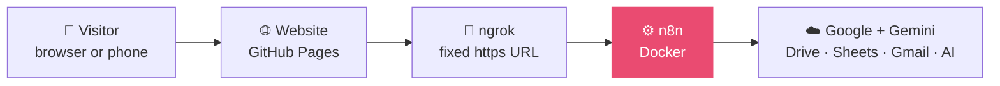
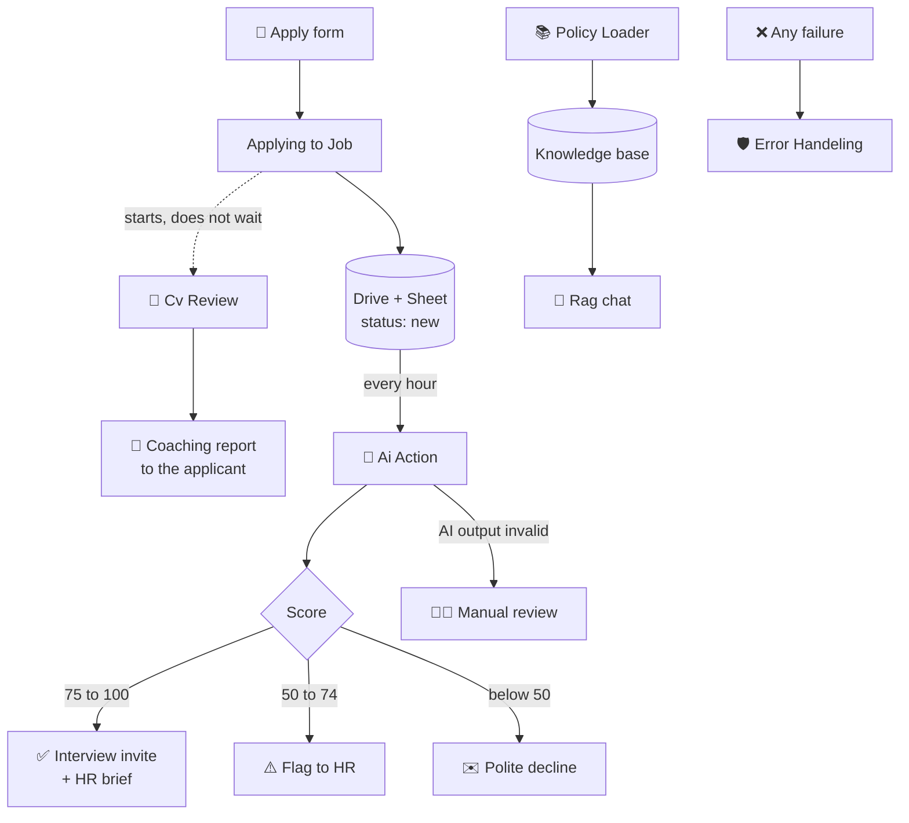

<div align="center">

# ✨ ATH Studios · n8n

### Hiring & HR, automated end to end

Apply with a PDF CV · AI scores every candidate · Get a personal coaching report · Ask an HR bot about policy · Never miss a failed run

<br>

<table>
<tr>
<td align="center" width="110"><br><sub><b>n8n</b></sub></td>
<td align="center" width="110"><br><sub><b>Google Gemini</b></sub></td>
<td align="center" width="110"><br><sub><b>Google Drive</b></sub></td>
<td align="center" width="110"><br><sub><b>Google Sheets</b></sub></td>
<td align="center" width="110"><br><sub><b>Gmail</b></sub></td>
<td align="center" width="110"><br><sub><b>Docker</b></sub></td>
<td align="center" width="110"><br><sub><b>GitHub Pages</b></sub></td>
</tr>
</table>

<br>

🧩 **6** workflows &nbsp;·&nbsp; 🤖 **AI** CV scoring & coaching &nbsp;·&nbsp; 💬 **RAG** policy-grounded chat &nbsp;·&nbsp; 🛡️ **24/7** monitoring

</div>

---

## 🚀 What is this?

A **live automation portfolio** built with [n8n](https://n8n.io). Every button on the landing page runs a real workflow, not a demo.

| | Feature | What you get |
| :-: | --- | --- |
| 📄 | **Apply for a job** | A validated application, CV saved to Drive, row logged in Sheets |
| 🎯 | **Get coached** | An AI report with match score, cover letter and interview questions, sent by email |
| 🤖 | **AI screening** | Every CV scored out of 100, then invite, decline or flag for HR |
| 💬 | **Ask HR** | A chatbot that answers **only** from the company's policy documents |
| 🛡️ | **Error monitoring** | Classified alerts, a daily digest and a heartbeat that catches silent failures |

---

## 🏗️ Architecture



Visitors only reach n8n through one fixed address. Credentials never leave n8n and are never exposed to the website.

---

## 🧩 Workflows

All files live in [`workflows/`](workflows/) and import straight into any n8n instance.

| | Workflow | Trigger | What it does |
| :-: | --- | --- | --- |
| 📝 | **Applying to Job** | Form | Validates the application, blocks duplicates, uploads the CV to Drive, logs a row with status `new`, then starts the CV Review |
| 🎯 | **Cv Review** | Form or called by *Applying to Job* | Four AI agents work as a team and email the applicant a full report |
| 🤖 | **Ai Action** | Hourly schedule | Scores new applications and routes the hiring decision |
| 💬 | **Rag** | Form + Chat | Loads documents into a vector store and answers questions only from them |
| 📚 | **Policy Loader** | On start · 7 AM daily · manual | Refreshes the knowledge base from Google Drive |
| 🛡️ | **Error Handeling** | Error trigger + schedules | Classifies, logs and reports every failure |

### 🔗 How they connect



> **Note:** *Applying to Job* starts *Cv Review* without waiting for it, so the applicant sees the thank-you page instantly. If the review fails, the application is still saved.

---

<details>
<summary><b>🎯 Cv Review: the AI agent team</b></summary>

<br>

A **Career Coach** orchestrator calls three specialists in order, then a fourth step handles the optional application email.

| Agent | Output |
| --- | --- |
| 🔍 **CV Matcher** | Match score out of 100, 4 strengths, 3 gaps, keywords to add |
| ✍️ **Cover Letter Writer** | A ready-to-send letter using only facts from the CV |
| 🎤 **Interview Coach** | 5 likely questions with short model answers, including one about the biggest gap |
| 📨 **Apply on Job** | If the job post contains a recruiter email, sends the application there |

The CV is read with Gemini, so even complex layouts are transcribed section by section.

</details>

<details>
<summary><b>🤖 Ai Action: scoring and decision rules</b></summary>

<br>

| Score | Decision | Result |
| :-: | --- | --- |
| **75 to 100** | ✅ Interview | Invitation to the candidate and a candidate brief with interview questions to HR |
| **50 to 74** | ⚠️ Maybe | Borderline case flagged to HR for a human decision |
| **below 50** | ❌ Declined | Polite decline email to the candidate |

**Scoring weights**

| Criterion | Points |
| --- | :-: |
| Required skills | 30 |
| Work experience | 25 |
| Projects | 15 |
| Education | 10 |
| Additional qualifications | 10 |
| Certifications | 5 |
| Languages | 5 |

Protected characteristics and contact details are never used for scoring. Scanned PDFs fall back to OCR. If the AI returns invalid output, the application is marked for **manual review** and HR is notified instead of guessing.

</details>

<details>
<summary><b>🛡️ Error Handeling: three layers of protection</b></summary>

<br>

| Layer | When | What it does |
| --- | --- | --- |
| 🚨 **Classify and alert** | On every failure | Sorts the error into `auth`, `data`, `unknown` (critical) or `rate_limit`, `network`, `ai_output` (warning). Logs it, de-duplicates by fingerprint, and emails the admin about critical errors at most once per problem per hour |
| 📰 **Daily digest** | Every day at 8 AM | One summary of the last 24 hours and everything still open |
| 💓 **Heartbeat** | Every 2 hours | Alerts if applications sit in status `new` for over 3 hours. This catches the case where nothing ran at all, which an error trigger can never see |

</details>

---

## ⚡ Quick start

### 1. Requirements

- [x] n8n (self-hosted, Docker recommended) with the Form, AI Agent and Gemini nodes
- [x] A Google account with Drive, Sheets and Gmail
- [x] A Google Gemini API key
- [x] ngrok or any HTTPS tunnel, if the public website must reach a local n8n

### 2. Import

Use **Import from file** in n8n. Import **Cv Review before Applying to Job**.

### 3. Add your credentials

Create Google Drive, Google Sheets, Gmail and Google Gemini credentials in n8n and select them in each node.

### 4. Replace the placeholders

| Placeholder | Where | Replace with |
| --- | --- | --- |
| `YOUR_ID` | Drive and Sheets nodes | Your Drive ID, Sheet ID and Gemini model |
| `YOUR_SENDTO` | Gmail nodes in *Ai Action* and *Error Handeling* | The HR or admin email |
| `YOUR_CV_REVIEW_WORKFLOW_ID` | **Run CV Review** node in *Applying to Job* | The ID of your imported *Cv Review* |
| `errorWorkflow` | Workflow settings | The ID of your imported *Error Handeling* |

### 5. Create the sheets

<details>
<summary><b>📊 Applications sheet columns</b></summary>

<br>

`Applied At` · `Name` · `Email` · `Position` · `Motivation` · `CV File ID` · `CV Link` · `Status` · `Score` · `Recommendation` · `Years Experience` · `Top Skills` · `Matched` · `Missing` · `Read Method` · `Problems` · `Evaluated At`

</details>

Also create an **error log sheet** for *Error Handeling*.

### 6. Load the policies and go live

Put your policy documents in the Drive folder used by *Policy Loader*, run **Reload Now** once, then activate the workflows.

### 7. Connect the website

Edit the `CONFIG` block in `index.html`:

```js
const CONFIG = {
  n8nBase: "https://YOUR-TUNNEL.ngrok-free.dev",
  chat: "/webhook/<chat-trigger-id>/chat",
  applyForm: "/form/<apply-form-id>",
  coachForm: "/form/<cv-review-form-id>"
};
```

Each ID is the `webhookId` of the matching trigger node:

| Setting | Trigger node | Workflow |
| --- | --- | --- |
| `applyForm` | Apply For a Job | Applying to Job |
| `coachForm` | Job Application Form | Cv Review |
| `chat` | When chat message received | Rag |

> **Tip:** the *Rag* chat only accepts requests from the origin in its **Allowed Origins** option. Set it to your own site.

---

## ✅ Testing checklist

- [ ] Submit the apply form with a real PDF: a row appears with a working **CV Link**
- [ ] The coaching report arrives by email within a few minutes
- [ ] Apply again with the same email and position: you see **Applied Before**
- [ ] Submit an invalid form (one-word name, non-PDF file): the exact errors are listed
- [ ] Run **Ai Action** manually: the row status changes and the right email is sent
- [ ] Ask the chat a policy question: the answer comes only from your documents
- [ ] Break a credential on purpose: the admin receives a critical alert

---

## 📁 Repository structure

```text
.
├── index.html                  🌐 Landing page (GitHub Pages)
├── README.md
└── workflows/
    ├── Applying to Job.json    📝 Application form
    ├── Cv Review.json          🎯 AI coaching report
    ├── Ai Action.json          🤖 Scoring and decisions
    ├── Rag.json                💬 Knowledge base + chat
    ├── Policy Loader.json      📚 Policy sync
    └── Error Handeling.json    🛡️ Monitoring
```

---

## ⚠️ Good to know

- **Placeholders only.** The workflow files are cleaned for sharing. Never commit real IDs, tokens or email addresses.
- **In-memory vector store.** The knowledge base is empty after an n8n restart, which is why *Policy Loader* also runs on start.
- **Two AI passes per applicant.** *Ai Action* evaluates for HR, and *Cv Review* coaches the applicant. Both read the same new application.

---

<div align="center">

### Built with ❤️ by **ATH Studios**

n8n · Google Gemini · Google Workspace · Docker · ngrok · GitHub Pages

</div>
